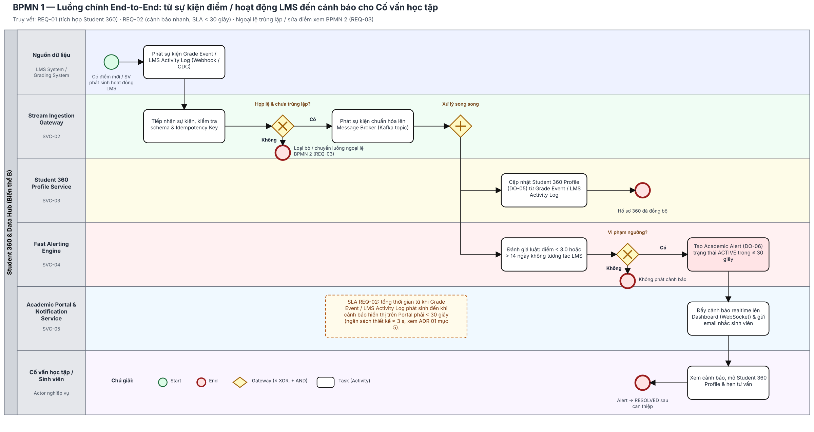
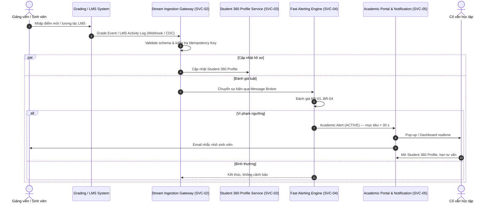

# 📑 HẠNG MỤC 1 - TV2: YÊU CẦU CHỨC NĂNG (FR) & BPMN 1 LUỒNG CHÍNH END-TO-END

> **Phạm vi:** `REQ-01` (tích hợp Student 360 + Dashboard) và `REQ-02` (cảnh báo nhanh < 30 giây).
> Phần xử lý trùng lặp / sửa điểm (`REQ-03`) do TV3 đặc tả chi tiết ở BPMN 2; tài liệu này chỉ nêu **hành vi hiển thị** của Portal (FR-12) để hai bên khớp nhau.
> Danh pháp tuân thủ `docs/00_universal_contract.md`: 4 nguồn `EXT-01..04`, 5 Core Services `SVC-01..05`, 6 Data Objects `DO-01..06`.

---

## 1. Tác nhân & Phạm vi hệ thống

| Tác nhân | Vai trò trong hệ thống |
|:---|:---|
| **Cố vấn học tập** | Người dùng chính của Portal: nhận cảnh báo, xem hồ sơ 360, tạo lịch tư vấn, đóng cảnh báo. |
| **Sinh viên** | Nhận email nhắc nhở học vụ; xem hồ sơ của chính mình. |
| **Giảng viên** | Nhập / sửa điểm trên `Grading System`, giao bài trên `LMS System` (nguồn phát sinh sự kiện). |
| **Ban Giám hiệu / Phòng Đào tạo** | Xem Dashboard thống kê toàn trường (chỉ đọc, dữ liệu đã tổng hợp). |

**Ngoài phạm vi (Out of scope):** thuật toán dự báo rủi ro bằng Machine Learning; chỉnh sửa dữ liệu gốc trên 4 hệ thống nguồn; chi tiết cơ chế chống trùng lặp (thuộc TV3 / `REQ-03`).

---

## 2. Quy tắc nghiệp vụ cảnh báo (Business Rules)

Các ngưỡng dưới đây lấy từ `REQ-02` trong Hợp đồng chung; **mức độ nghiêm trọng (severity) là đề xuất của TV2** để làm rõ cách `Fast Alerting Engine` phân loại, nhóm có thể điều chỉnh khi họp.

| Mã luật | Điều kiện kích hoạt | Nguồn dữ liệu | Severity (`DO-06`) |
|:---:|:---|:---|:---:|
| **BR-01** | Điểm kiểm tra / giữa kỳ < 3.0 (thang 10) | `Grade Event` (`DO-03`) | `WARNING` |
| **BR-02** | Sinh viên không có hoạt động LMS > 14 ngày liên tiếp (hoặc vắng > 3 buổi điểm danh) | `LMS Activity Log` (`DO-02`) | `WARNING` |
| **BR-03** | Cùng một sinh viên thỏa đồng thời BR-01 và BR-02 | `DO-02` + `DO-03` | `CRITICAL` |
| **BR-04** | Điểm trong khoảng 3.0 ≤ điểm < 4.0 (sát ngưỡng, cần theo dõi) | `DO-03` | `INFO` |

Vòng đời `Academic Alert`: `ACTIVE` → (`RESOLVED` khi Cố vấn đã can thiệp xong) hoặc (`REVOKED` khi điểm được đính chính làm điều kiện luật không còn đúng — `REQ-03`).

---

## 3. Bộ Yêu Cầu Chức Năng (FR)

Ký hiệu cột **Ưu tiên**: **M** = Must have, **S** = Should have. Cột **Service** cho biết Core Service chịu trách nhiệm chính.

### Nhóm 1 — Tích hợp & tổng hợp hồ sơ 360 (`REQ-01`)

| ID | Yêu cầu | Service | Data Object | Ưu tiên | Tiêu chí chấp nhận |
|:---:|:---|:---:|:---:|:---:|:---|
| **FR-01** | Nhận và lưu thông tin đầu vào của sinh viên từ `Admission System`. | SVC-01 | DO-01 | M | Sau mỗi lần đồng bộ lô, 100% bản ghi hợp lệ có `student_id` được upsert vào hồ sơ; bản ghi lỗi được ghi log & đưa vào hàng chờ xử lý lại. |
| **FR-02** | Thu nạp điểm học phần từ `Grading System`, tính CPA / GPA và số tín chỉ đạt, nợ. | SVC-02, SVC-03 | DO-03, DO-05 | M | Khi có `Grade Event` mới, các trường `cpa`, `gpa_latest`, `credits_*` trong hồ sơ được cập nhật trong vòng vài giây. |
| **FR-03** | Ghi nhận nhật ký học tập từ `LMS System`: đăng nhập cuối, tỷ lệ nộp bài, số buổi vắng. | SVC-02, SVC-03 | DO-02, DO-05 | M | `lms_summary.days_inactive` luôn phản ánh sự kiện LMS mới nhất của sinh viên. |
| **FR-04** | Thu nạp tình trạng việc làm cựu sinh viên từ `Career & Alumni System`. | SVC-01 | DO-04, DO-05 | S | Với sinh viên đã tốt nghiệp, trường `career_alumni_info` được điền; sinh viên đang học có giá trị `null`. |
| **FR-05** | Hợp nhất 4 nguồn thành **một** `Student 360 Profile` theo khóa `student_id` (Single Source of Truth). | SVC-03 | DO-05 | M | Mỗi `student_id` có đúng 1 hồ sơ; dữ liệu mâu thuẫn được xử lý theo quy tắc ở tài liệu 02 (mục 4.2). |
| **FR-06** | Cung cấp API và giao diện tra cứu hồ sơ 360 trên một màn hình (Single Pane of Glass). | SVC-03, SVC-05 | DO-05 | M | Cố vấn nhập MSSV (hoặc bấm từ danh sách) và thấy đủ 4 nhóm thông tin; API trả về JSON hợp lệ theo `student_360_profile_schema.json`. |

### Nhóm 2 — Phát hiện nguy cơ & cảnh báo nhanh (`REQ-02`)

| ID | Yêu cầu | Service | Data Object | Ưu tiên | Tiêu chí chấp nhận |
|:---:|:---|:---:|:---:|:---:|:---|
| **FR-07** | Tự động đánh giá luật **BR-01 / BR-04** mỗi khi có `Grade Event`. | SVC-04 | DO-03 | M | Với điểm 2.5 → sinh cảnh báo `WARNING`; điểm 3.5 → `INFO`; điểm 6.0 → không cảnh báo. |
| **FR-08** | Tự động đánh giá luật **BR-02** dựa trên `LMS Activity Log` (kiểm tra theo sự kiện và quét định kỳ cho sinh viên không phát sinh sự kiện). | SVC-04 | DO-02 | M | Sinh viên 15 ngày không hoạt động bị gắn cảnh báo `WARNING` ở lần quét kế tiếp. |
| **FR-09** | Nâng mức `CRITICAL` khi thỏa đồng thời **BR-01 + BR-02** (BR-03). | SVC-04 | DO-02, DO-03 | M | Alert đang `WARNING` của sinh viên được nâng lên `CRITICAL`, không tạo bản ghi trùng. |
| **FR-10** | Sinh bản ghi `Academic Alert` (`alert_id`, `severity`, `trigger_reason`, `latency_seconds`, `status = ACTIVE`) **trong tối đa 30 giây** kể từ khi sự kiện phát sinh. | SVC-04 | DO-06 | M | `latency_seconds` thường < 30 theo `REQ-02` trong điều kiện tải bình thường (tỷ lệ phần trăm cụ thể do TV3 chốt ở NFR). |
| **FR-11** | Hiển thị cảnh báo tức thì trên Portal (pop-up/banner + dòng mới ở danh sách) và gửi email nhắc nhở tới sinh viên. | SVC-05 | DO-06 | M | Khi Alert mới được tạo, Dashboard của Cố vấn cập nhật không cần tải lại trang; email được xếp hàng gửi. |
| **FR-12** | Hiển thị đúng trạng thái `REVOKED` / `RESOLVED` của Alert và hồ sơ 360 sau khi điểm được đính chính. | SVC-05, SVC-03 | DO-05, DO-06 | M | Alert bị thu hồi hiển thị gạch ngang, không còn nằm trong bộ đếm "Active"; hồ sơ 360 hiện điểm mới. *(Cơ chế thu hồi: xem BPMN 2 của TV3.)* |

### Nhóm 3 — Dashboard & xử lý của Cố vấn

| ID | Yêu cầu | Service | Data Object | Ưu tiên | Tiêu chí chấp nhận |
|:---:|:---|:---:|:---:|:---:|:---|
| **FR-13** | Dashboard thống kê: tổng số sinh viên, số sinh viên có nguy cơ, số Alert đang `ACTIVE`, độ trễ cảnh báo gần nhất, danh sách sinh viên cần chú ý. | SVC-05 | DO-05, DO-06 | M | Các chỉ số khớp với dữ liệu hồ sơ 360 và bảng Alert tại cùng thời điểm. |
| **FR-14** | Cố vấn mở cảnh báo → xem hồ sơ 360 → tạo lịch hẹn tư vấn → đánh dấu `RESOLVED` khi xong. | SVC-05 | DO-06 | S | Mỗi thao tác đổi trạng thái được ghi lại (người thực hiện, thời điểm). |
| **FR-15** | Phân quyền xem dữ liệu: Cố vấn chỉ thấy sinh viên được phân công; Sinh viên chỉ thấy hồ sơ của mình; Ban Giám hiệu chỉ thấy số liệu tổng hợp. | SVC-05, SVC-03 | DO-05 | S | Truy cập trái quyền bị từ chối và ghi nhật ký (liên quan rủi ro lộ thông tin sinh viên của TV1). |

---

## 4. Đặc Tả Quy Trình Nghiệp Vụ BPMN 1 (Luồng chính End-to-End)

*File nguồn: `diagrams/src/bpmn_core_flow.py` (sinh ra `bpmn_core_flow.svg` / `.png`). Muốn chỉnh sửa, sửa tọa độ trong file `.py` rồi chạy lại `python bpmn_core_flow.py`.*

### 4.1 Diễn giải từng bước

| Bước | Lane / Service | Hoạt động | Data Object | FR liên quan |
|:---:|:---|:---|:---:|:---:|
| 1 | Nguồn dữ liệu (EXT-03 / EXT-04) | Có điểm mới hoặc sinh viên phát sinh hoạt động LMS → nguồn phát sự kiện (Webhook / CDC). | DO-03, DO-02 | FR-02, FR-03 |
| 2 | `Stream Ingestion Gateway` (SVC-02) | Tiếp nhận, kiểm tra schema và `Idempotency Key`. Bản tin sai/trùng → rẽ sang luồng ngoại lệ **BPMN 2** (`REQ-03`). | DO-02, DO-03 | — |
| 3 | `Stream Ingestion Gateway` (SVC-02) | Bản tin hợp lệ được chuẩn hóa và phát lên Message Broker. Cổng song song (AND) tách hai nhánh xử lý. | — | — |
| 4a | `Student 360 Profile Service` (SVC-03) | **Nhánh A:** cập nhật `Student 360 Profile` (CPA, `days_inactive`, điểm môn). | DO-05 | FR-05 |
| 4b | `Fast Alerting Engine` (SVC-04) | **Nhánh B:** đánh giá luật BR-01..BR-04. Không vi phạm → kết thúc. | DO-02, DO-03 | FR-07..09 |
| 5 | `Fast Alerting Engine` (SVC-04) | Vi phạm → tạo `Academic Alert` trạng thái `ACTIVE`, ghi `latency_seconds`. | DO-06 | FR-10 |
| 6 | `Academic Portal & Notification Service` (SVC-05) | Đẩy cảnh báo realtime lên Dashboard (WebSocket) và gửi email nhắc sinh viên. | DO-06 | FR-11 |
| 7 | Cố vấn học tập | Xem cảnh báo, mở hồ sơ 360, hẹn tư vấn; xong thì đánh dấu `RESOLVED`. | DO-05, DO-06 | FR-06, FR-14 |

### 4.2 Sơ đồ tuần tự bổ trợ (Mermaid)

---

## 5. Truy vết yêu cầu (phần của TV2)

| Yêu cầu | FR | Thành phần kiến trúc | Minh chứng trong repo |
|:---:|:---|:---|:---|
| `REQ-01` | FR-01..06, FR-13 | SVC-01, SVC-02, SVC-03, SVC-05 | `02_archimate_c4_schema.md`, `schemas/student_360_profile_schema.json`, tab Hồ sơ 360 & Dashboard trong `mock-ui/` |
| `REQ-02` | FR-07..11 | SVC-02, SVC-04, SVC-05 | BPMN 1, tab Cảnh báo nhanh trong `mock-ui/`, `03_adr_01_integration.md` |
| `REQ-03` | FR-12 (hiển thị) | SVC-03, SVC-05 | Phối hợp với BPMN 2 của TV3; nút "Sửa điểm & Thu hồi" trong `mock-ui/` |
