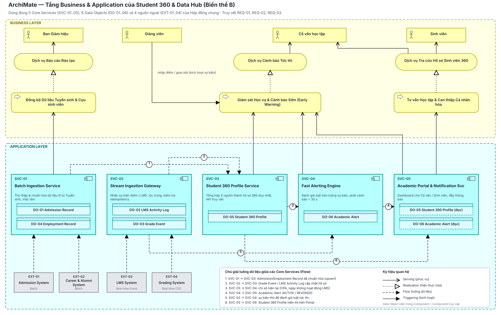
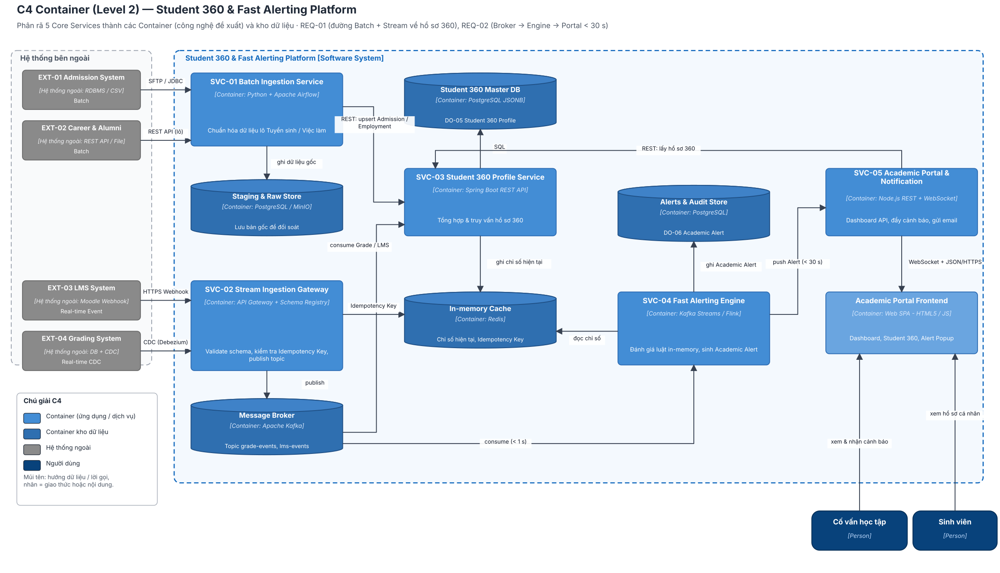
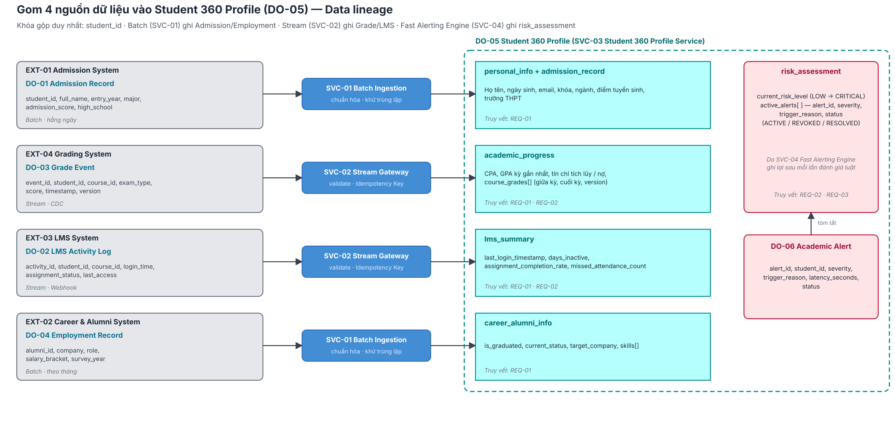

# 📑 HẠNG MỤC 2 - TV2: ARCHIMATE (BUSINESS & APPLICATION), CẤU TRÚC DỮ LIỆU STUDENT 360 & C4 CONTAINER

> Tất cả sơ đồ dùng đúng danh pháp Hợp đồng chung: `EXT-01..04`, `SVC-01..05`, `DO-01..06`.
> File nguồn sơ đồ nằm ở `diagrams/src/` (Python sinh SVG, không cần cài thêm thư viện); ảnh PNG/SVG nằm ở `diagrams/`.

---

## 1. Sơ đồ ArchiMate tầng Nghiệp vụ & Ứng dụng

### 1.1 Tầng Business

| Loại phần tử | Phần tử | Ghi chú |
|:---|:---|:---|
| Business Actor | Sinh viên, Giảng viên, Cố vấn học tập, Ban Giám hiệu | Giảng viên *kích hoạt* quy trình giám sát thông qua việc nhập điểm / giao bài. |
| Business Process | Đồng bộ Dữ liệu Tuyển sinh & Cựu sinh viên; Giám sát Học vụ & Cảnh báo Sớm; Tư vấn Học tập & Can thiệp Cá nhân hóa | Process *realize* các Business Service. |
| Business Service | Dịch vụ Báo cáo Đào tạo; Dịch vụ Cảnh báo Tức thì; Dịch vụ Tra cứu Hồ sơ Sinh viên 360 | Business Service *phục vụ* (serve) các Actor. |

### 1.2 Tầng Application

| Core Service (Application Component) | Data Object truy cập | Phục vụ Business Process |
|:---|:---|:---|
| `SVC-01` Batch Ingestion Service | `DO-01` Admission Record, `DO-04` Employment Record | Đồng bộ Dữ liệu Tuyển sinh & Cựu sinh viên |
| `SVC-02` Stream Ingestion Gateway | `DO-02` LMS Activity Log, `DO-03` Grade Event | (hạ tầng nội bộ: cấp dữ liệu cho SVC-03 và SVC-04) |
| `SVC-03` Student 360 Profile Service | `DO-05` Student 360 Profile | Giám sát Học vụ & Cảnh báo Sớm |
| `SVC-04` Fast Alerting Engine | `DO-06` Academic Alert (ghi); đọc chỉ số từ `DO-05` | Giám sát Học vụ & Cảnh báo Sớm |
| `SVC-05` Academic Portal & Notification Service | Đọc `DO-05`, `DO-06` | Tư vấn Học tập & Can thiệp; Giám sát Học vụ & Cảnh báo Sớm |

Luồng dữ liệu giữa các Core Services (chấm số trong sơ đồ):
1. `SVC-01 → SVC-03`: dữ liệu Tuyển sinh / Việc làm đã chuẩn hóa.
2. `SVC-02 → SVC-03`: `Grade Event`, `LMS Activity Log` cập nhật hồ sơ.
3. `SVC-03 → SVC-04`: chỉ số hiện tại (CPA, số ngày không hoạt động LMS).
4. `SVC-04 → SVC-05`: `Academic Alert` (`ACTIVE` / `REVOKED`).
5. `SVC-02 → SVC-04`: sự kiện thô để đánh giá luật tức thì.
6. `SVC-03 → SVC-05`: hồ sơ 360 hiển thị trên Portal.

---

## 2. Sơ đồ C4 Container (Level 2)

**Công nghệ trong sơ đồ là đề xuất** để làm rõ ranh giới triển khai; hạ tầng chi tiết (cụm Kafka, Redis, node xử lý luồng) do TV3 đặc tả ở ArchiMate Technology và phải khớp với bảng ánh xạ dưới đây.

| Core Service | Container đề xuất | Kho dữ liệu đi kèm | Giao thức chính |
|:---|:---|:---|:---|
| `SVC-01` | Python + Apache Airflow | Staging & Raw Store (PostgreSQL / MinIO) | SFTP / JDBC / REST (theo lô) → REST upsert sang SVC-03 |
| `SVC-02` | API Gateway + Schema Registry | Message Broker (Kafka), Redis (Idempotency Key) | HTTPS Webhook, CDC (Debezium) → publish topic |
| `SVC-03` | Spring Boot REST API | Student 360 Master DB (PostgreSQL JSONB), Redis | REST / SQL |
| `SVC-04` | Kafka Streams / Flink (luật in-memory) | Alerts & Audit Store (PostgreSQL), đọc Redis | Consume Kafka → push Alert |
| `SVC-05` | Node.js REST + WebSocket; Web SPA | — | WebSocket + JSON/HTTPS, SMTP |

---

## 3. Cấu trúc dữ liệu Hồ sơ Student 360 (`DO-05`)

### 3.1 Gom 4 nguồn vào một hồ sơ

### 3.2 Bảng ánh xạ trường dữ liệu

| Nhóm trường trong `Student 360 Profile` | Nguồn | Data Object | Cơ chế nạp | Trường chính |
|:---|:---|:---:|:---:|:---|
| `personal_info`, `admission_record` | `EXT-01 Admission System` | `DO-01` | Batch (SVC-01) | `student_id`, `full_name`, `entry_year` (→ `cohort`), `major`, `admission_score`, `high_school` |
| `academic_progress` | `EXT-04 Grading System` | `DO-03` | Stream / CDC (SVC-02) | `cpa`, `gpa_latest`, `credits_accumulated`, `credits_debt`, `course_grades[]` (điểm theo môn, `grade_version`, `last_event_id`) |
| `lms_summary` | `EXT-03 LMS System` | `DO-02` | Stream / Webhook (SVC-02) | `last_login_timestamp`, `days_inactive`, `assignment_completion_rate`, `missed_attendance_count` |
| `career_alumni_info` | `EXT-02 Career & Alumni System` | `DO-04` | Batch (SVC-01) | `alumni_id`, `company`, `role`, `salary_bracket`, `survey_year`, `is_graduated`, `current_status`, `target_company`, `skills[]` |
| `risk_assessment` | Tính ra bởi `SVC-04` | `DO-06` | Ghi lại sau mỗi lần đánh giá luật | `current_risk_level`, `active_alerts[]` (`alert_id`, `severity`, `status`...) |

> **Đối chiếu với Hợp đồng chung:** schema giữ đủ các trường của `DO-01` (`entry_year`; `cohort` là trường dẫn xuất, ví dụ 2021 → K66) và `DO-04` (`alumni_id`, `company`, `role`, `salary_bracket`, `survey_year`); `course_grades[].grade_version` / `last_event_id` truy về `DO-03.version` / `event_id`; `active_alerts[].latency_seconds` lấy từ `DO-06`.

### 3.3 Khóa & quy tắc hợp nhất (Survivorship)

| Vấn đề | Quy tắc đề xuất |
|:---|:---|
| Khóa định danh | `student_id` là khóa duy nhất giữa 4 nguồn; `alumni_id` của `DO-04` được ánh xạ về `student_id` khi sinh viên tốt nghiệp. |
| Điểm bị sửa (nhiều `version`) | Giữ `version` cao nhất của cùng `(student_id, course_id, exam_type)`; các phiên bản cũ lưu ở lịch sử để truy vết. |
| Sự kiện đến trước hồ sơ | Nếu `Grade Event` / `LMS Activity Log` đến trước bản ghi Tuyển sinh, `SVC-03` tạo hồ sơ tạm (placeholder) và bổ sung khi lô Tuyển sinh về (xem ADR 01 mục 4). |
| Giá trị dẫn xuất | `days_inactive`, `cpa`, `credits_debt` do `SVC-03` tính lại mỗi lần có sự kiện; không nhận từ nguồn. |
| Dữ liệu cá nhân | Chỉ trường cần thiết hiển thị cho đúng vai trò (xem FR-15). |

### 3.4 JSON Schema

Định nghĩa đầy đủ ở `schemas/student_360_profile_schema.json` (JSON Schema 2020-12). Bản ghi mẫu hợp lệ của sinh viên 20210001: `schemas/student_360_profile_example.json` (đã kiểm tra khớp schema).

---

## 4. Danh mục sản phẩm bàn giao của Hạng mục 2

| Sản phẩm | File |
|:---|:---|
| ArchiMate Business & Application | `diagrams/archimate_app_bus.png` / `.svg` |
| C4 Container | `diagrams/c4_container.png` / `.svg` |
| Sơ đồ gom 4 nguồn vào hồ sơ 360 | `diagrams/student360_lineage.png` / `.svg` |
| JSON Schema hồ sơ 360 + bản ghi mẫu | `schemas/student_360_profile_schema.json`, `schemas/student_360_profile_example.json` |
| Mã nguồn sinh sơ đồ | `diagrams/src/*.py` |
