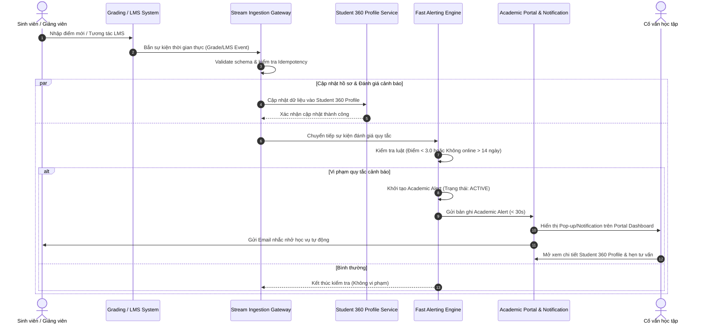

# 📑 TUẦN 1 - TV2: YÊU CẦU CHỨC NĂNG (FR) & SƠ ĐỒ BPMN LUỒNG CHÍNH

## 1. Bộ Yêu Cầu Chức Năng Chi Tiết (Functional Requirements - FR)

Hệ thống cung cấp các nhóm chức năng cốt lõi được mã hóa gắn liền với `REQ-01` và `REQ-02`:

### Nhóm 1: Tích Hợp & Tổng Hợp Dữ Liệu Hồ Sơ 360 (`REQ-01`)
- **FR-01 (Nhập dữ liệu tuyển sinh):** Hệ thống có khả năng nhận và lưu trữ thông tin đầu vào của sinh viên từ `Admission System` (Mã SV, ngành học, điểm thi tuyển sinh, trường THPT).
- **FR-02 (Tích hợp tiến độ đào tạo & điểm số):** Tự động thu nạp điểm các học phần từ `Grading System`, tính toán điểm trung bình tích lũy (CPA) và số tín chỉ hoàn thành theo từng kỳ.
- **FR-03 (Tích hợp nhật ký học tập trực tuyến):** Ghi nhận tần suất truy cập, thời gian đăng nhập cuối cùng, tiến độ nộp bài tập và xem bài giảng từ `LMS System`.
- **FR-04 (Tích hợp thông tin việc làm cựu sinh viên):** Thu nạp thông tin tình trạng việc làm và mức thu nhập khảo sát từ `Career & Alumni System` để phục vụ phân tích xu hướng và cố vấn định hướng nghề nghiệp.
- **FR-05 (Truy vấn hồ sơ Student 360):** Cung cấp API và giao diện cho phép xem tổng quan mọi khía cạnh thông tin của một sinh viên trên một màn hình duy nhất (Single Pane of Glass).

### Nhóm 2: Phát Hiện Nguy Cơ & Cảnh Báo Nhanh Tức Thì (`REQ-02`)
- **FR-06 (Quy tắc phát hiện điểm kém):** Tự động kích hoạt kiểm tra khi có sự kiện `Grade Event`. Nếu điểm bài kiểm tra/giữa kỳ < 3.0 (thang 10) hoặc < 1.0 (thang 4), đánh giá ngay nguy cơ trượt học phần.
- **FR-07 (Quy tắc phát hiện nguy cơ bỏ học):** Định kỳ kiểm tra nhật ký `LMS Activity Log`. Nếu sinh viên không có hoạt động tương tác trong vòng 14 ngày liên tiếp hoặc vắng mặt trên 3 buổi điểm danh, hệ thống kích hoạt cảnh báo chuyên cần.
- **FR-08 (Phát sinh Academic Alert):** Động cơ `Fast Alerting Engine` sinh ra bản ghi `Academic Alert` kèm mức độ ưu tiên (INFO, WARNING, CRITICAL) trong vòng tối đa **30 giây** kể từ khi nhận sự kiện.
- **FR-09 (Bắn thông báo đa kênh):** `Academic Portal & Notification Service` hiển thị pop-up/banner cảnh báo trên giao diện Cố vấn học tập và đồng thời gửi email thông báo nhắc nhở đến sinh viên.

---

## 2. Đặc Tả Quy Trình Nghiệp Vụ BPMN 1 (Luồng Chính End-to-End)

### Kịch bản nghiệp vụ:
1. **Sự kiện bắt đầu:** Sinh viên có điểm kiểm tra mới được nhập vào `Grading System` hoặc sinh viên phát sinh hoạt động trên `LMS System`.
2. **Tiếp nhận sự kiện:** `Stream Ingestion Gateway` bắt sự kiện thời gian thực thông qua cơ chế Webhook / CDC, giải mã và kiểm tra tính hợp lệ của bản tin.
3. **Cập nhật hồ sơ:** Sự kiện được chuyển tiếp đến `Student 360 Profile Service` để cập nhật trạng thái mới nhất vào bản ghi `Student 360 Profile`.
4. **Đánh giá quy tắc:** Đồng thời, sự kiện được đưa vào `Fast Alerting Engine`. Engine đối chiếu các tiêu chí luật (Ngưỡng điểm số < 3.0, Tần suất vắng học LMS).
5. **Kích hoạt cảnh báo:**
   - Nếu *Không vi phạm ngưỡng*: Quy trình kết thúc êm đẹp.
   - Nếu *Vi phạm ngưỡng*: Engine khởi tạo bản ghi `Academic Alert` với trạng thái `ACTIVE`.
6. **Thông báo & Tương tác:** Bản ghi cảnh báo được gửi sang `Academic Portal & Notification Service`. Hệ thống hiển thị cảnh báo đỏ trên Dashboard của Cố vấn học tập và gửi email cảnh báo sớm cho sinh viên.
7. **Hành động can thiệp:** Cố vấn học tập click vào thông báo để mở xem chi tiết `Student 360 Profile` của sinh viên, nắm bắt nguyên nhân và tạo lịch hẹn tư vấn trực tiếp.

> **Ghi chú bàn giao sơ đồ:** Vẽ sơ đồ BPMN chi tiết bằng công cụ Camunda Modeler, Draw.io hoặc Signavio; lưu file nguồn `.bpmn` và file ảnh `.png` tại thư mục `docs/02_tv2_core_student360/diagrams/bpmn_core_flow.png`.
