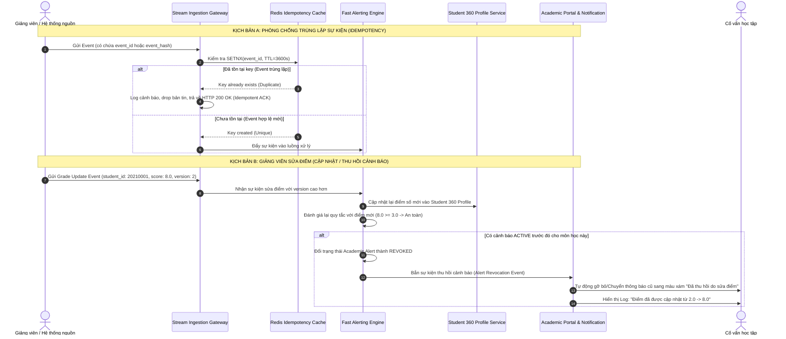

# 📑 TUẦN 1 - TV3: YÊU CẦU PHI CHỨC NĂNG (NFR) & BPMN LUỒNG NGOẠI LỆ

## 1. Bộ Yêu Cầu Phi Chức Năng (Non-Functional Requirements - NFR) Cho Biến Thể B

Hệ thống cảnh báo nhanh và xử lý ngoại lệ phải tuân thủ các chỉ số kỹ thuật khắt khe sau:

| Mã NFR | Tên chỉ tiêu phi chức năng | Tiêu chuẩn kỹ thuật (Target Metric) | Lý do nghiệp vụ & Thách thức |
|:---:|---|---|---|
| **NFR-01** | **Độ trễ cảnh báo (Latency SLA)** | **< 30 giây** (từ lúc sự kiện phát sinh đến lúc Cố vấn học tập nhìn thấy thông báo trên UI). | Yêu cầu cốt lõi của Biến thể B; giúp cố vấn can thiệp trước khi sinh viên buông xuôi học phần. |
| **NFR-02** | **Thông lượng chịu tải (Throughput & Scalability)** | Chịu tải đỉnh tối thiểu **2.000 sự kiện/giây (EPS)** mà không làm tăng độ trễ vượt quá 45 giây. | Vào mùa thi cuối kỳ, hàng chục giảng viên nộp điểm đồng thời cho hàng nghìn sinh viên cùng lúc. |
| **NFR-03** | **Tính chống trùng lặp (Idempotency)** | **100% bản tin trùng lặp bị lọc bỏ**, không sinh 2 cảnh báo giống nhau trong cùng 1 cửa sổ thời gian. | Do mạng không dây hoặc lỗi retry của LMS, cùng một request có thể gửi 2-3 lần liên tiếp. |
| **NFR-04** | **Tính sẵn sàng (Availability)** | Đạt mức **99.9% uptime** trong suốt thời gian học kỳ chính thức. | Hệ thống ngừng hoạt động sẽ làm mất vết các sự kiện điểm bất thường của sinh viên. |
| **NFR-05** | **Thời gian thu hồi cảnh báo (Revocation Time)** | **< 15 giây** kể từ khi nhận được sự kiện đính chính / sửa điểm từ giảng viên. | Giảm thiểu tối đa hoang mang cho sinh viên và cố vấn khi xảy ra sự cố nhập nhầm điểm. |

---

## 2. Đặc Tả Quy Trình Nghiệp Vụ BPMN 2 (Luồng Ngoại Lệ Của Biến Thể B)

Luồng ngoại lệ giải quyết 2 tình huống đặc thù theo yêu cầu `REQ-03`:
1. **Tình huống 1: Giảng viên sửa điểm sau khi vừa phát cảnh báo** (Ví dụ: Nhập nhầm điểm 2.0, sau 1 phút sửa lại thành 8.0).
2. **Tình huống 2: Bản tin sự kiện bị gửi trùng lặp hoặc sai định dạng**.

> **Ghi chú bàn giao sơ đồ:** Vẽ sơ đồ BPMN chi tiết gồm các Gateway rẽ nhánh kiểm tra trùng lặp và sự kiện Timer Boundary Event; lưu file ảnh tại thư mục `docs/03_tv3_realtime_alerting/diagrams/bpmn_exception_flow.png`.
